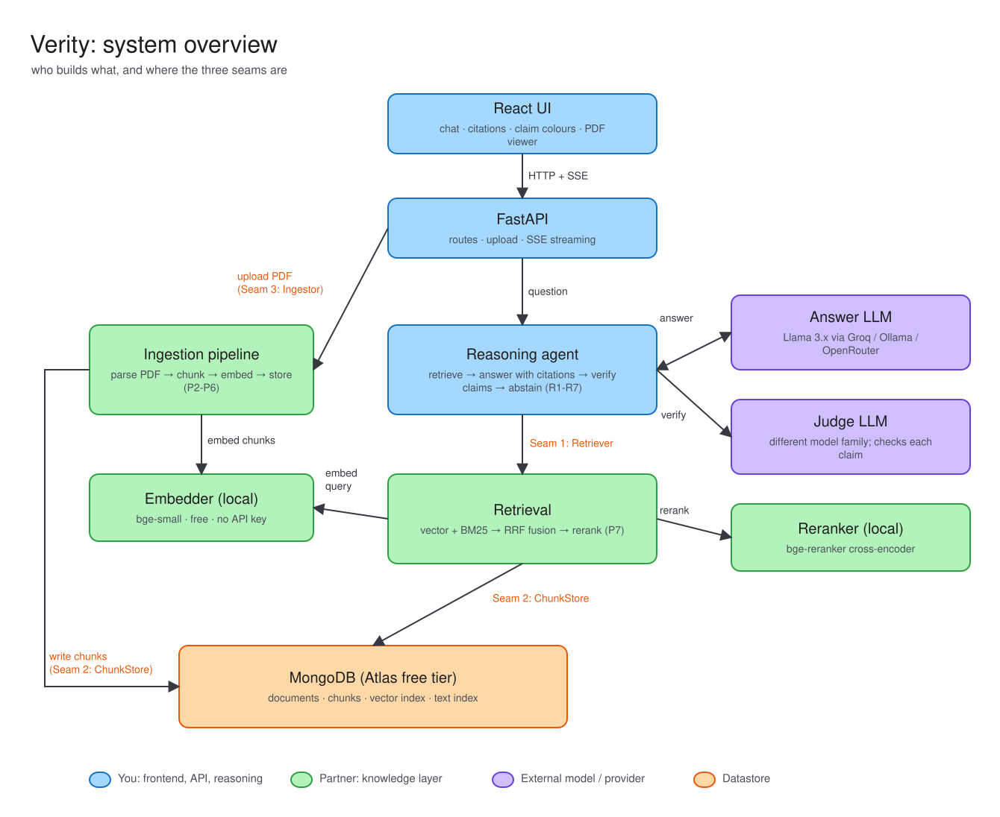
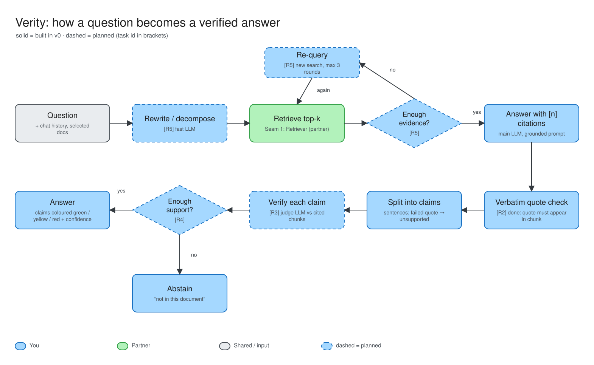
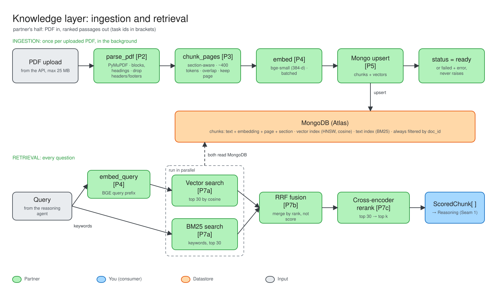
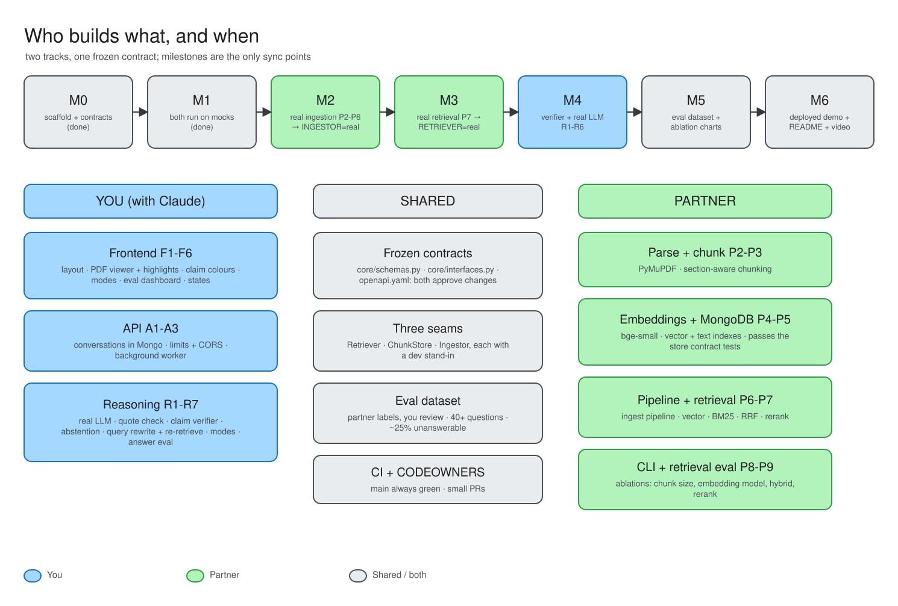

# Verity

Upload a paper, then learn from it with a chatbot that **shows its evidence and says "I don't know"**
instead of making things up.

Most "chat with your PDF" apps answer confidently whether or not the document supports it. Verity is
built around the opposite goal, and measures it:

- **Grounded answers**: every sentence cites a page and an exact quote.
- **Claim-level verification**: each claim in an answer is checked against its cited passages
  (supported / unsupported / contradicted), shown as green / yellow / red in the UI.
- **Abstention**: if the paper doesn't say, the answer is "not in this document".
- **Fact-check mode**: paste a statement; get a verdict *according to the paper*, with evidence.
- **Teacher mode**: step-by-step explanations plus a check-your-understanding question.
- **Evals**: retrieval and hallucination are measured with an ablation table, not vibes.

> Honest scope: the system can tell you what a *document* supports or contradicts. It cannot know what
> is true in the world; "correct vs wrong" always means "per the uploaded text".

## Run it (no API keys, no database)

```bash
make setup && make setup-web     # one time
make api                         # terminal 1: API on :8000 (mock LLM, demo document preloaded)
make web                         # terminal 2: UI on :5173
make test                        # backend tests
```

Everything runs offline by default: in-memory store, keyword retriever, mock LLM. Each piece is swapped
for the real thing via env switches in `.env` as it gets built (see `.env.example`, `docs/ARCHITECTURE.md`).

## Who owns what

| | Owner | Directories |
|---|---|---|
| **Reasoning + API + UI** | you (with Claude) | `frontend/`, `backend/app/api/`, `backend/app/reasoning/`, `backend/evals/answer_eval.py` |
| **Knowledge layer** | partner | `backend/app/knowledge/`, `backend/tests/knowledge/`, `backend/evals/retrieval_eval.py` |
| **Shared & frozen** | both approve changes | `backend/app/core/`, `contracts/`, `backend/evals/dataset/` |

Partner: start at **[docs/PARTNER_GUIDE.md](docs/PARTNER_GUIDE.md)**.
Everyone: **[docs/WORKSTREAMS.md](docs/WORKSTREAMS.md)** (tasks + milestones) and
**[docs/ARCHITECTURE.md](docs/ARCHITECTURE.md)**.

## Diagrams


System overview: who builds what and where the three seams are.


How a question becomes a verified answer, step by step.


The partner's half: PDF ingestion and hybrid retrieval.


Who builds what, and when, across milestones M0 to M6.

The matching `.excalidraw` files in `docs/diagrams/` open at [excalidraw.com](https://excalidraw.com) (File > Open) for editing.

## Stack

Python 3.12 + FastAPI · React + Vite + TypeScript · MongoDB (Atlas Vector Search + Atlas Search) ·
local open embedding/reranker models (BGE) · open LLMs on free tiers via any OpenAI-compatible
endpoint (`docs/LLM_PROVIDERS.md`).

## Layout

```
backend/app/core/        frozen contracts (schemas, interfaces)
backend/app/knowledge/   ingestion, storage, retrieval     (partner)
backend/app/reasoning/   answer agent, citations, verifier (you)
backend/app/api/         FastAPI routes + SSE              (you)
backend/app/llm/         provider-agnostic LLM client + mock
backend/app/dev/         stand-ins used until the real parts land
backend/evals/           datasets, metrics, eval runners
frontend/                React app
contracts/openapi.yaml   API contract
```
